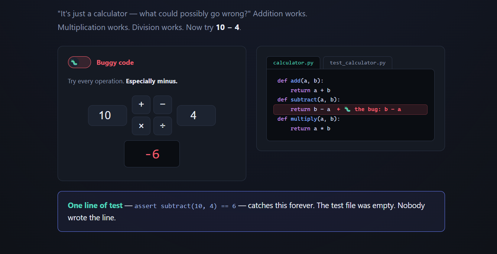
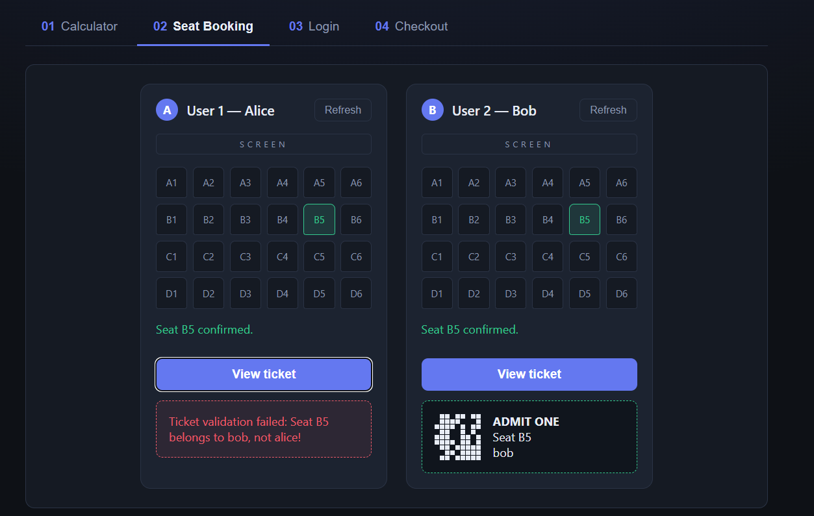
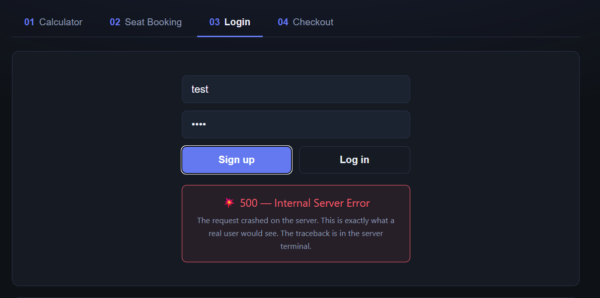
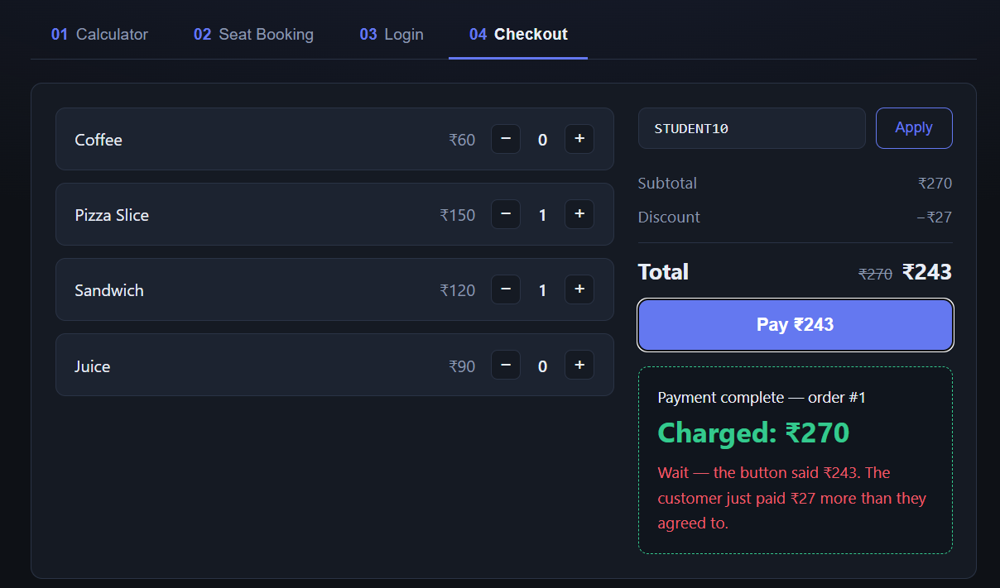
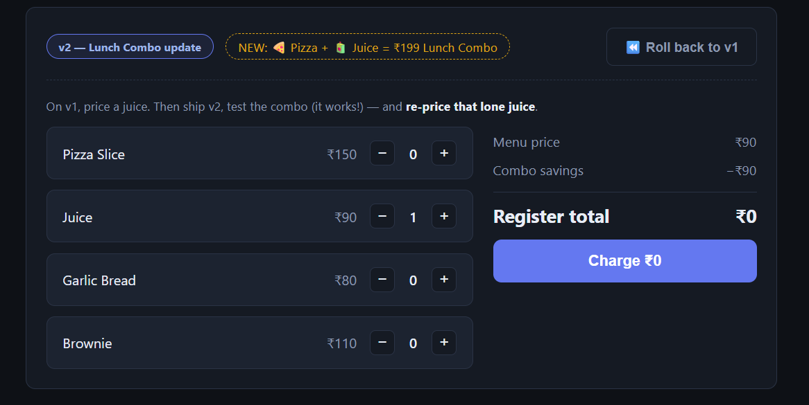
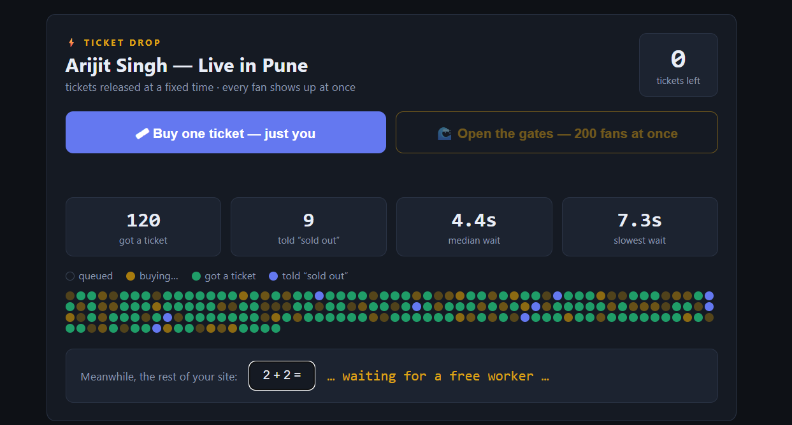
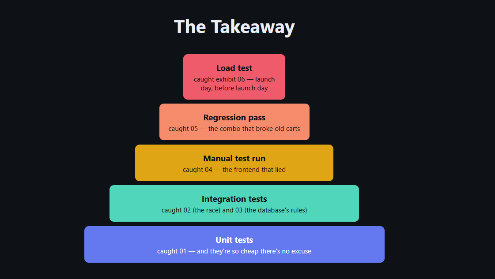

# I built six broken apps to explain why we write tests

“Write tests” is excellent advice and a terrible explanation.

It makes testing sound like one homogeneous activity where more is always better. A team can write fifty unit tests, see a wall of green ticks, and still ship a button that charges the wrong amount. The tests did not lie; they answered narrower questions than the team thought they had asked.

I wanted a way to make that distinction visible, so I built **Why We Write Tests**: a FastAPI workshop containing six deliberately broken applications. Each one fails for a different reason, and each needs a different kind of safety net.

The project is both a live application and a teaching exercise. The audience uses the app, triggers a failure, reads the relevant code, and decides which test would have exposed it. Some demos have missing tests. More importantly, some have passing tests and broken behaviour.



## The central idea: a green suite is a precise, limited claim

When a test suite passes, it does not prove that “the software works.” It proves that its assertions passed with the inputs, dependencies, timing, environment, and load used during that run.

That distinction is why testing has layers:

- **Unit tests** exercise a small function or class in isolation. They are fast, cheap, and give precise feedback.
- **Integration tests** include a real boundary such as a database, HTTP API, filesystem, queue, or another service. They are slower but catch incorrect assumptions between components.
- **End-to-end tests** follow a complete user journey through the deployed system. They provide broad confidence but cost more to run and are usually harder to diagnose.
- **Manual exploratory and acceptance testing** can notice confusing interactions, visual errors, and mismatches with what a person actually needs.
- **Performance tests** examine behaviour over time and under concurrency: questions ordinary functional assertions do not ask.

This is the familiar testing pyramid. Keep a wide base of quick unit tests, a smaller set of integration tests, and a focused set of expensive full-flow checks. It is a guide to balancing speed, cost, and release confidence—not a quota.

Test doubles such as mocks and fakes can make isolated tests fast and deterministic, but every substituted dependency also removes some reality. At the other end, end-to-end tests include more reality but are slower and more vulnerable to timing, data, and environment flakiness. The useful suite is the one whose layers match the risks in the product.

## What I built

The backend is intentionally small: Python, FastAPI, SQLite, and one module per scenario. A single HTML frontend is served by FastAPI, so the whole workshop starts with one command and one URL.

```text
backend/
  main.py          # FastAPI routes and reset endpoint
  calculator.py    # a tiny logic bug
  booking.py       # a concurrency bug
  users.py         # an unhandled database constraint
  checkout.py      # correct backend, broken frontend flow
  pizzashop.py     # a v2 regression
  flashsale.py     # a capacity failure
frontend/
  index.html       # interactive live workshop
tests/
  unit/            # isolated tests
  integration/     # real database/API checks to reveal during the demo
demo-site/
  index.html       # standalone version for static hosting
BUGS.md            # instructor-only spoilers and fixes
```

The `/api/reset` endpoint recreates both SQLite databases and clears all in-memory demo state. Restarting the server also starts clean. That detail matters in a workshop: every audience should see the same failure, and yesterday's booking must not spoil today's race condition.

```python
@app.post("/api/reset")
def reset():
    booking.reset_db()
    users.reset_db()
    checkout.reset()
    pizzashop.reset()
    flashsale.reset()
    return {"ok": True}
```

There is also a self-contained static version in `demo-site/index.html`. It simulates the six exhibits without a Python server and can be deployed directly to a static host. The live version is better for running the real tests and HTTP load; the static version is useful when I only need the visual lesson.

## Demo 1: the calculator that could not subtract

The first application is deliberately ordinary. Addition, multiplication, and division work, so a quick click around creates confidence. Subtraction reverses its operands:

```python
def subtract(a, b):
    return b - a
```

Enter `10 - 4` and the UI returns `-6`. The corresponding test file contains no active tests because “it is just a calculator.” The test that would have caught the defect is almost embarrassingly small:

```python
def test_subtract():
    assert calculator.subtract(10, 4) == 6
```

That is exactly the lesson. Simple code is not the same as infallible code. A cheap unit test is appropriate when the behaviour is deterministic and all the required state fits in the function call.

The calculator also demonstrates why an empty test file can look harmless in automation: pytest collects no calculator tests and the rest of the suite remains green. A pipeline should therefore care about which behaviours are represented, not only the final exit code.

## Demo 2: two users, one seat

The seat-booking tab places Alice and Bob beside the same 24-seat map. If they both choose B3 within the fake payment window, both see a successful booking. Only one name remains in SQLite, so the other person's ticket is invalid.



The bug is a classic check-then-act race:

```python
def book_seat(seat_id, user):
    with connect() as db:
        taken = db.execute(
            "SELECT booked_by FROM seats WHERE id = ?", (seat_id,)
        ).fetchone()[0]
        if taken:
            return {"ok": False, "error": "Seat is already booked"}

        time.sleep(random.uniform(*PAYMENT_DELAY))
        db.execute(
            "UPDATE seats SET booked_by = ? WHERE id = ?",
            (user, seat_id),
        )
    return {"ok": True, "seat": seat_id, "user": user}
```

The sequential unit tests all pass. They book a free seat, then try a taken seat. Real users do not promise to arrive one at a time, though. Alice and Bob can both read `NULL`, both wait for payment, and both update the same row.

An integration test has to create the condition the unit suite omitted:

```python
def test_two_users_race_for_the_same_seat():
    booking.reset_db()
    results = []

    def grab(user):
        results.append(booking.book_seat("B3", user))

    alice = threading.Thread(target=grab, args=("alice",))
    bob = threading.Thread(target=grab, args=("bob",))
    alice.start()
    bob.start()
    alice.join()
    bob.join()

    wins = [result for result in results if result["ok"]]
    assert len(wins) == 1
```

The safe implementation turns the check and claim into one conditional write. SQLite then decides atomically which request wins:

```python
claimed = db.execute(
    "UPDATE seats SET booked_by = ? "
    "WHERE id = ? AND booked_by IS NULL",
    (user, seat_id),
)
if claimed.rowcount == 0:
    return {"ok": False, "error": f"Seat {seat_id} is already booked"}
```

The lesson is not merely “use a database.” It is that concurrency is part of the specification. A one-at-a-time test cannot establish an exactly-one-winner invariant.

## Demo 3: the second Alice

The login form accepts the first Alice. A second signup with the same username produces a 500 Internal Server Error.



The unit tests validate usernames and passwords, then sign up and log in one user. They all pass. The real table adds a rule the isolated checks never exercise:

```python
db.execute(
    "CREATE TABLE users (username TEXT UNIQUE, password TEXT)"
)
```

`signup()` performs the insert without handling the database exception:

```python
with connect() as db:
    db.execute("INSERT INTO users VALUES (?, ?)", (username, password))
```

An API-level integration test signs up Alice twice. The expected product behaviour is a polite, structured rejection; the actual behaviour is an escaping `sqlite3.IntegrityError`.

```python
first = client.post("/api/signup", json=user)
second = client.post("/api/signup", json=user)

assert first.json()["ok"] is True
assert second.json()["ok"] is False
assert "taken" in second.json()["error"]
```

The appropriate fix catches the real database constraint:

```python
try:
    with connect() as db:
        db.execute("INSERT INTO users VALUES (?, ?)", (username, password))
except sqlite3.IntegrityError:
    return {"ok": False, "error": "That username is already taken"}
```

Validation and persistence are different boundaries. Application validation improves the response, while the unique constraint remains the final protection against concurrent or alternative clients. An integration test verifies that the two layers cooperate.

## Demo 4: the discount that never left the screen

The snack shop is the uncomfortable one: its unit tests pass, its integration tests pass, and its backend is correct.

The user adds coffee and pizza, applies `STUDENT10`, and sees a discounted total of ₹189. The Pay button promises that amount. The receipt says ₹210.



The backend correctly accepts and applies a code:

```python
def pay(items, code=""):
    charged = apply_discount(cart_total(items), code)
    order = {"items": items, "code": code, "charged": charged}
    orders.append(order)
    return order
```

The frontend preview sends the code, but the payment handler forgets it:

```javascript
payBtn.onclick = async () => {
  const order = await api("/api/pay", { items: cart });
};
```

Backend tests can prove that `/api/pay` charges ₹189 when it receives `STUDENT10`, and ₹210 when it receives no code. Both assertions are true. Neither proves that the browser sends the value displayed to the customer.

The immediate fix is small:

```javascript
const code = discounted !== null
  ? document.getElementById("codeInput").value.toUpperCase()
  : "";
const order = await api("/api/pay", { items: cart, code });
```

The broader fix is coverage at the missing boundary: a browser end-to-end test or a deliberate manual checkout run. This demo makes a crucial point: adding more backend tests would not increase confidence in the broken path.

## Demo 5: the combo that made juice free

The pizza shop begins on v1, where every line item is added normally. v2 introduces a ₹199 lunch combo for one pizza and one juice. The new combo tests pass, so the release looks safe.

Then I press **Ship v2**. A juice by itself costs ₹0. Two pizzas and one juice cost ₹199 rather than ₹349.



Here is the refactor:

```python
def cart_total_v2(items):
    combos = min(items.get("pizza", 0), items.get("juice", 0))
    total = combos * COMBO_PRICE
    for product_id, qty in items.items():
        if product_id in ("pizza", "juice"):
            continue
        total += price_of(product_id) * qty
    return total
```

The loop skips every pizza and juice, not only the quantities consumed by combos. The suite contains old v1 tests and new v2 combo tests:

```python
def test_single_item_cart():
    assert pizzashop.cart_total({"juice": 1}) == 90  # runs on v1

def test_combo_prices_pizza_plus_juice_at_199():
    pizzashop.ship(2)
    assert pizzashop.cart_total({"pizza": 1, "juice": 1}) == 199
```

Both pass. Nobody re-runs the old cart scenarios after activating v2. This is a regression gap: a changed shared pricing function preserved the new case and broke established behaviour.

The demo intentionally does not ship a code fix. Instead, the UI presents a release checklist so participants manually rerun the old flows against v2. In a real project, those checks should become automated parameterized regression tests. Every escaped defect should add a durable example to the suite.

Undercharging makes the story especially useful. Customers report obvious failures and overcharges; almost nobody complains when an item becomes free. Some defects require proactive detection because production feedback will be late or silent.

## Demo 6: it worked for one fan

The final app sells 120 concert tickets. Buying one ticket works. Selling the last ticket works. Trying after sell-out returns the correct error. Every functional test passes.

Then **Open the gates** launches 200 simulated fans against the real HTTP endpoint.



Each purchase represents a slow payment:

```python
def buy(user):
    global tickets_left
    time.sleep(random.uniform(*PAYMENT_DELAY))
    with _stock_lock:
        if tickets_left > 0:
            tickets_left -= 1
            return {"ok": True, "user": user, "left": tickets_left}
    return {"ok": False, "error": "Sold out", "left": 0}
```

The lock protects stock, so this is not the same correctness bug as seat booking. The problem is capacity. `/api/flashsale/buy` is synchronous, each request occupies a worker thread for 1.5–3 seconds, and roughly 40 threads must serve 200 buyers in waves. Late fans wait many seconds merely to learn that tickets are gone. Other synchronous endpoints share the exhausted pool, so even the calculator becomes sluggish during the sale.

The simulator spawns clients against the actual server rather than calling `buy()` directly. The async results endpoint stays responsive enough for the UI to poll and draw each fan's state.

There is no single intentionally “wrong” line and no patch included. The missing practice is a load test performed before launch. Tools such as Locust, k6, or JMeter can model traffic and record throughput, latency percentiles, failures, and saturation.

Performance testing includes several distinct experiments:

- **Load testing** checks expected traffic against latency and error-rate targets.
- **Stress testing** pushes beyond the expected peak to find the breaking point and failure behaviour.
- **Spike testing** introduces a sudden surge and measures recovery.
- **Soak testing** sustains traffic long enough to reveal leaks and gradual degradation.

Locust is particularly convenient here because user behaviour is Python code, lives in version control, can run headlessly in CI, and can scale out to workers. The important thing is not the brand of tool. It is turning “fast enough” into a measurable workload and threshold.

## What the six failures cover

| Demo | Existing evidence | What it misses | Right next test |
|---|---|---|---|
| Calculator | No active calculator test | Basic deterministic logic | Unit test |
| Seat booking | Sequential unit tests | Two requests racing for one resource | Concurrent integration test |
| Login | Validation and happy-path unit tests | Real database constraint and API error handling | Database/API integration test |
| Checkout | Correct backend unit and API tests | Browser sends a different payload from the displayed state | End-to-end or manual flow |
| Pizza shop v2 | Old v1 tests and new-feature v2 tests | Established cases on changed code | Regression suite |
| Flash sale | Functional purchase and sell-out tests | Latency, queueing, and shared capacity at 200 users | Load test |



## Testing around the pyramid

The deck I built for this workshop goes beyond unit, integration, and end-to-end tests because release confidence is a lifecycle, not a single suite.

**Regression testing** reruns established behaviour after changes. It belongs on pull requests and before releases. A fixed defect should become a regression test, while obsolete tests should be removed when they no longer describe the product.

**Smoke testing** is wide and shallow: immediately after deployment, can the application start and can its critical routes function well enough to continue testing? A failed smoke test rejects the build early. **Sanity testing** is narrow and deep: after a particular patch, does that change behave as intended before the wider suite runs?

**System Integration Testing (SIT)** exercises the system with its databases, APIs, queues, payment providers, and other dependencies in a realistic shared environment. It catches contract mismatches, timeouts, missing error handling, and configuration that only worked locally.

**User Acceptance Testing (UAT)** asks business owners or real users to confirm that the result meets the actual need. SIT asks, “Did we build it right?” UAT asks, “Did we build the right thing?” Passing agreed scenarios and recording sign-off are product decisions, not substitutes for engineering tests.

**Static analysis** inspects code without running it. Linters, dependency scanners, and platforms such as SonarQube can reveal vulnerabilities, duplication, complexity, suspicious code, and maintainability problems a passing test will not necessarily expose.

**Code coverage** is useful evidence, but it is easy to overread. Line coverage says code executed. Branch coverage says alternatives such as both sides of an `if` executed. Neither says the test made a meaningful assertion. I treat coverage as a floor and a map of suspicious gaps, not a target to game. Applying a stronger threshold to changed code can improve a legacy project without demanding an unrealistic overnight rewrite.

**Quality gates** turn standards into automated merge or release decisions: no failing tests, minimum coverage on new code, no new critical vulnerabilities, and agreed complexity or duplication limits. Exceptions can exist, but they should be explicit, recorded, and time-boxed.

A practical lifecycle looks like this:

1. During **build**, review requirements, write test cases, run unit and integration tests on commits, review code, and perform static checks.
2. During **verification**, smoke-test the deployed build, run regression and SIT, and exercise performance and security risks.
3. During **acceptance and release**, complete UAT, obtain sign-off, deploy, run production smoke checks, monitor, and turn escaped defects into tests.

Not every project needs every ceremony at the same scale. A static personal site and a ticketing system carry different risks. The principle is to name the failure that matters, then choose the cheapest observation point capable of detecting it.

## Running the project

The live workshop requires Python 3.10 or newer and `uv`:

```bash
cd why_test_cases
uv sync
uv run uvicorn backend.main:app --port 1184 --reload
```

Open `http://localhost:1184`. Each tab includes its own click-by-click walkthrough. Reset the scenarios from the UI or with:

```bash
curl -X POST http://localhost:1184/api/reset
```

Run the active suite with:

```bash
uv run pytest
```

The intentionally missing integration examples are commented out so the workshop initially stays green. Reveal and uncomment them one scenario at a time. The checkout integration tests are the exception: they pass when enabled because the backend is genuinely correct, which pushes the investigation toward the browser boundary.

For a backend-free preview:

```bash
python3 -m http.server 1185 --directory demo-site
```

Then open `http://localhost:1185`.

## How I use it as a workshop

For each exhibit, I first let the audience use the product and reproduce the failure. We then inspect the smallest relevant code and ask three questions:

1. What claim do the current tests actually establish?
2. Which condition or boundary is absent?
3. What is the cheapest reliable test that would catch this class of defect?

For demos one to three, we reveal a failing test, make the smallest fix, rerun the suite, and return to the UI. For checkout, the backend suite stays green while we trace the browser payload. For pizza v2, we perform the release checklist and discuss regression selection. For the flash sale, we watch latency and queueing grow instead of pretending another functional assertion would solve a capacity question.

The instructor keeps `BUGS.md` off the projector. It documents every intentional defect, expected failure, and possible fix so the exercise remains repeatable without giving away the answer.

## The lesson I wanted to keep

Testing is not a tax paid after programming, and “more tests” is not a useful strategy by itself.

Tests are observation points. Unit tests observe local logic. Integration tests observe boundaries. End-to-end and manual checks observe user journeys. Regression tests preserve behaviour across change. Load tests observe time, contention, and capacity. Static analysis observes properties without executing the program. UAT observes whether the product solves the intended problem.

The best test is not the largest or most fashionable one. It is the smallest trustworthy test that can see the risk you care about.

Six broken apps made that idea far more memorable than another slide saying testing is important.
